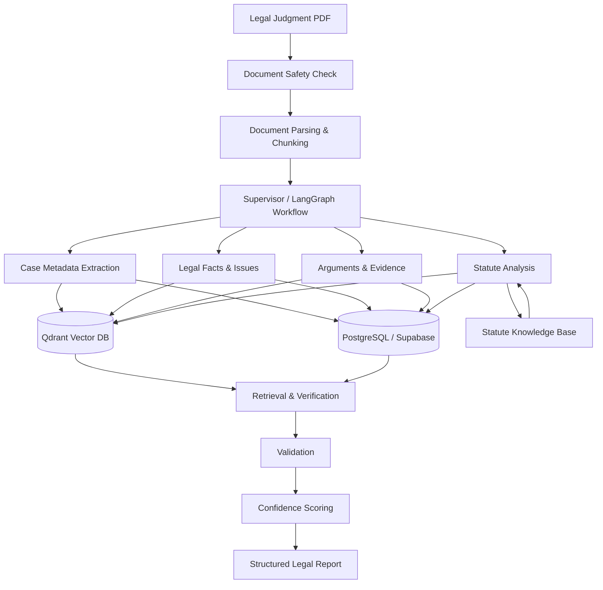

<div align="center">

# ⚖️ Legal.ai

### AI-Powered Multi-Agent Case-Law Intelligence & Analysis Platform

[](https://www.python.org/)
[](https://www.langchain.com/langgraph)
[](https://qdrant.tech/)
[](https://www.postgresql.org/)
[](https://www.docker.com/)

🏆 **National 2nd Prize Winner — Deloitte Hacksplosion 2026**
*Selected from 22,000+ applicants*

</div>

---

## 🚀 Overview

**Legal.ai** is a multi-agent AI platform for transforming complex legal judgments into **structured, traceable, and verifiable case-law intelligence**.

The system processes legal PDFs, extracts important case information, analyzes statutory references, retrieves relevant legal knowledge, validates generated results, and produces structured outputs with supporting evidence and confidence signals.

The project is built around a **Supervisor-Worker architecture using LangGraph**, with dedicated components for document processing, extraction, retrieval, statute verification, validation, and observability.

> **Core idea:** Use AI to accelerate legal document analysis without treating an LLM's output as automatically correct.

---

## 🏆 Achievement

**National 2nd Prize — Deloitte Hacksplosion 2026**

Legal.ai was recognized with the **2nd prize nationally** at Deloitte Hacksplosion 2026, competing among **22,000+ applicants**.

---

## ✨ Key Features

* 🤖 **Multi-Agent Legal Analysis** — Coordinates specialized AI components through a LangGraph workflow.
* 📄 **Legal PDF Intelligence** — Parses and processes lengthy court judgments and legal documents.
* 🧠 **LLM-Powered Information Extraction** — Extracts structured case information from unstructured legal text.
* 🔎 **Semantic Retrieval** — Uses embeddings and Qdrant for vector-based retrieval.
* ⚖️ **Statute Knowledge Base** — Supports ingestion, lookup, mapping, and verification of statutory information.
* 🛡️ **PDF Safety Checks** — Screens documents before downstream AI processing.
* ✅ **Evidence-Based Validation** — Separates extraction from validation to reduce unsupported claims.
* 📊 **Confidence Scoring** — Combines validation signals to assess the reliability of extracted information.
* 🔄 **Retry & Validation Workflow** — Allows questionable outputs to be re-evaluated within the pipeline.
* 🗃️ **Structured Outputs** — Converts complex judgments into machine-readable legal information.
* 🔭 **LLM Observability** — Integrates Langfuse for tracing and monitoring AI workflows.
* 🌐 **REST API (FastAPI)** — Upload a judgment, poll live progress, review paused runs and fetch results over HTTP.
* 🖥️ **Web App (React)** — Upload, watch each pipeline step, click any extracted value to see its source quote and PDF page, and approve or edit low-confidence results.
* 📏 **Evaluation Framework** — Scores outputs against hand-labelled judgments: accuracy, wrong-answer rate, abstention rate, P/R/F1 and confidence calibration.
* 🐳 **Dockerized Execution** — Provides a reproducible environment for document processing and ingestion.

---

## 🏛️ System Architecture

Legal.ai follows a **Supervisor-Worker orchestration pattern** where a central workflow coordinates specialized processing stages.



### High-Level Flow

```text
Legal PDF
   │
   ▼
Safety & Parsing
   │
   ▼
Document Chunking
   │
   ▼
Supervisor / LangGraph
   │
   ├──► Case Metadata
   ├──► Facts & Issues
   ├──► Arguments & Evidence
   └──► Statute Analysis
              │
              ▼
       Retrieval / Knowledge Base
              │
              ▼
          Validation
              │
              ▼
       Confidence Scoring
              │
              ▼
      Structured Legal Output
```

---

## 🧩 Core Engineering Concepts

### 1. Supervisor-Worker Workflow

Instead of sending an entire judgment to one monolithic prompt, Legal.ai divides the workflow into specialized stages.

```text
                    ┌─────────────────┐
                    │    Supervisor   │
                    └────────┬────────┘
                             │
          ┌──────────────────┼──────────────────┐
          ▼                  ▼                  ▼
   Metadata Agent      Evidence Agent     Statute Agent
          │                  │                  │
          └──────────────────┼──────────────────┘
                             ▼
                       Validation
                             │
                             ▼
                     Final Structured
                          Output
```

This makes the pipeline easier to extend, test, observe, and validate.

---

### 2. Retrieval-Augmented Legal Intelligence

Legal.ai combines LLM reasoning with vector retrieval rather than relying solely on model memory.

```text
Legal Text
    │
    ▼
Embeddings
    │
    ▼
Qdrant
    │
    ▼
Relevant Context
    │
    ▼
LLM / Agent
    │
    ▼
Validated Result
```

This architecture helps ground generated information in retrieved document or knowledge-base context.

---

### 3. Statute Verification

The dedicated `statute_kb/` layer supports legal statute handling through:

* Act registration
* Statute ingestion
* Legal text parsing
* Statute lookup
* Legal mappings
* Citation verification

The goal is to distinguish between **what an LLM claims a statute says** and **what can be verified against the project's legal knowledge source**.

---

### 4. Evidence & Confidence

Legal.ai is designed so that extracted information can be associated with supporting source context.

A simplified reliability flow is:

```text
Extraction
    │
    ▼
Source Evidence
    │
    ▼
Validation
    │
    ▼
Consistency Checks
    │
    ▼
Confidence Score
```

This provides a more useful signal than simply returning an LLM response.

---

### 5. Document Safety

Legal documents are treated as untrusted input.

Before AI processing, the pipeline includes document safety checks intended to reduce risks from malicious or adversarial document content.

```text
PDF
 │
 ▼
Safety Check
 │
 ├── Unsafe → Reject
 │
 └── Safe
      │
      ▼
   AI Pipeline
```

---

## 🛠️ Tech Stack

| Technology                | Role                                   |
| ------------------------- | -------------------------------------- |
| **Python 3.12+**          | Core application                       |
| **LangGraph**             | Agent/workflow orchestration           |
| **LangChain**             | LLM application framework              |
| **OpenAI**                | LLM-powered processing                 |
| **Docling**               | PDF/document parsing                   |
| **Qdrant**                | Vector database and semantic retrieval |
| **PostgreSQL / Supabase** | Persistent application data            |
| **SQLAlchemy**            | Database access                        |
| **Sentence Transformers** | Embeddings                             |
| **FlagEmbedding**         | Embedding and retrieval models         |
| **Pydantic**              | Structured data validation             |
| **Langfuse**              | LLM observability and tracing          |
| **FastAPI + Uvicorn**     | HTTP API, background job runner        |
| **React + Vite + TypeScript** | Web UI                             |
| **nginx**                 | Serves the UI, proxies `/api`          |
| **pytest**                | API and evaluation tests               |
| **Docker**                | Reproducible execution environment     |

---

## 📁 Project Structure

```text
Legal.ai/
│
├── api/                    # FastAPI app: jobs, worker, demo mode
├── data/                   # Data and supporting resources
├── db/                     # Database schema and utilities
│
├── docs/
│   └── architecture/       # Architecture documentation
│
├── observability/          # LLM tracing and observability
│
├── pipeline/
│   ├── agents/             # Specialized processing agents
│   ├── chunking.py         # Document chunking
│   ├── embeddings.py       # Embedding generation
│   ├── graph.py            # LangGraph workflow
│   ├── validation.py       # Output validation
│   ├── confidence.py       # Confidence scoring
│   ├── pdf_safety.py       # PDF safety checks
│   ├── statute_verification.py
│   └── run.py              # Pipeline entry point
│
├── evaluation/             # Gold labels, scorer, reports
├── schemas/                # Pydantic schemas
├── scripts/                # Utility/setup scripts
├── tests/                  # pytest: API + evaluation
├── ui/                     # React web app
│
├── statute_kb/
│   ├── acts.py             # Legal acts registry
│   ├── ingest.py           # Knowledge-base ingestion
│   ├── lookup.py           # Statute retrieval
│   ├── mappings.py         # Legal mappings
│   └── parser.py           # Statute parsing
│
├── Dockerfile
├── docker-compose.yml
├── pyproject.toml
└── README.md
```

---

## 🔄 Processing Pipeline

### Step 1 — Ingestion

A court judgment PDF is supplied to the pipeline.

### Step 2 — Safety Validation

The document is checked before it enters the AI workflow.

### Step 3 — Parsing

Docling extracts usable text and document structure.

### Step 4 — Chunking

Long documents are divided into retrieval-friendly sections.

### Step 5 — Agentic Extraction

Specialized workflow stages identify information such as:

* Case metadata
* Facts
* Legal issues
* Arguments
* Evidence
* Statutory references

### Step 6 — Retrieval & Verification

Relevant information is retrieved from the vector store and statute knowledge base.

### Step 7 — Validation

The extracted information is checked against available source context and validation rules.

### Step 8 — Confidence Scoring

The pipeline produces confidence signals for the resulting information.

### Step 9 — Structured Output

The final result is returned in a structured, machine-readable format.

---

## 📊 Example Output

A processed judgment can be represented in a structure similar to:

```json
{
  "case_metadata": {
    "case_name": "...",
    "court": "...",
    "date": "...",
    "case_number": "..."
  },
  "facts": [
    "...",
    "..."
  ],
  "issues": [
    "..."
  ],
  "arguments": {
    "petitioner": [],
    "respondent": []
  },
  "statutes": [
    {
      "act": "...",
      "section": "...",
      "verified": true
    }
  ],
  "evidence": [
    {
      "claim": "...",
      "source": "..."
    }
  ],
  "confidence": 0.0
}
```

> The exact schema and fields depend on the document and pipeline configuration.

---

## 📦 Installation

### Prerequisites

* Python **3.12+**
* Docker
* Docker Compose
* PostgreSQL / Supabase
* Required LLM/API credentials

### 1. Clone the repository

```bash
git clone https://github.com/vineeethh/Legal.ai.git
cd Legal.ai
```

### 2. Configure environment variables

Create your environment file:

```bash
cp .env.example .env
```

Add the required API and database credentials to `.env`.

**Never commit API keys or other secrets to GitHub.**

### 3. Start the services

```bash
docker compose up -d qdrant
```

Qdrant is exposed on:

```text
http://localhost:6333
```

### 4. Build the application

```bash
docker compose build
```

### 5. Initialize the database

```bash
docker compose run --rm app python -m db.apply_schema
```

---

## ▶️ Running the Pipeline

Process a legal judgment with:

```bash
docker compose run --rm app python -m pipeline.run path/to/judgment.pdf
```

The supported Docker workflow keeps document-processing dependencies and model caches inside the containerized environment.

---

## 🌐 Web App & API

Start the API and the web app:

```bash
docker compose up -d qdrant api ui
```

* Web app: `http://localhost:3000`
* API docs (Swagger): `http://localhost:8000/docs`

**No Docling, GPU or LLM key on your machine?** Set `LEGAL_AI_DEMO_MODE=1` and the API returns a
synthetic result instead of running the pipeline, so the whole app can be demoed anywhere:

```bash
pip install fastapi "uvicorn[standard]" python-multipart pydantic python-dotenv
cd ui && npm install && npm run build && cd ..
LEGAL_AI_DEMO_MODE=1 uvicorn api.main:app --port 8000   # UI + API on http://localhost:8000
```

In demo mode, a file name containing `review` triggers the human-review pause and `unsafe` triggers
a rejection.

| Method | Endpoint | Purpose |
| ------ | -------- | ------- |
| `POST` | `/api/documents` | Upload a PDF → `202` + job id; processing starts in the background |
| `GET` | `/api/documents` | All runs, newest first |
| `GET` | `/api/documents/{id}` | Status and live per-agent progress |
| `GET` | `/api/documents/{id}/review` | Flagged fields, when the run paused for review |
| `POST` | `/api/documents/{id}/review` | `approve`, `reject` or `edit`; the paused graph resumes |
| `GET` | `/api/documents/{id}/result` | The structured judgment |
| `GET` | `/api/documents/{id}/pdf` | The uploaded PDF |
| `GET` | `/api/eval/reports/latest` | The newest evaluation report |

Set `API_KEY` to require an `X-API-Key` header on every endpoint except `/api/health`.

---

## 📏 Evaluation

```bash
python -m evaluation.run_eval            # score predictions against evaluation/gold/
docker compose run --rm app python -m evaluation.run_eval --run   # run the pipeline first
```

See [evaluation/README.md](evaluation/README.md) for the label format and what each metric means.

## 🧪 Tests

```bash
pip install -e ".[dev]"   # or just: fastapi httpx pytest python-multipart pydantic python-dotenv
pytest
```

The tests cover the API (in demo mode) and the evaluation scorer, so they run without Docling or an LLM.

---

## 🔭 Observability

Legal.ai integrates **Langfuse** to provide visibility into LLM workflows.

Observability can help with:

* Prompt/response tracing
* Workflow debugging
* Agent execution analysis
* Latency monitoring
* Token/cost analysis
* Identifying failure points

This is particularly important when developing multi-stage LLM systems where failures can occur at different points in the pipeline.

---

## 🎯 Use Cases

Legal.ai can serve as a foundation for:

* ⚖️ Legal research assistants
* 📚 Case-law analysis
* 🔎 Legal information retrieval
* 📝 Judgment summarization
* 🧑‍⚖️ Legal practitioner research tools
* 🗂️ Legal document structuring
* 🏛️ Compliance and regulatory analysis
* 🤖 RAG-based legal applications
* 📊 Legal analytics platforms

---

## 🧠 Areas of Technical Focus

This project combines:

**Generative AI × Agentic AI × RAG × NLP × Document Intelligence × Legal Technology**

Key areas explored:

* Large Language Models
* Multi-Agent Systems
* LangGraph
* Retrieval-Augmented Generation
* Semantic Search
* Vector Databases
* Information Extraction
* Document Intelligence
* Knowledge Bases
* LLM Evaluation
* AI Safety
* Observability
* Explainable AI

---

## 🗺️ Roadmap

* [x] Web-based legal analysis interface
* [x] Interactive source-to-claim navigation
* [ ] Expanded Indian statute knowledge base
* [ ] Case-law citation graph
* [x] Human-in-the-loop review interface
* [x] Automated evaluation framework (benchmark labels still to be collected)
* [ ] Regression test suite for legal documents
* [x] API layer (FastAPI; job queue and user accounts still to do)
* [ ] Multilingual Indian legal document support
* [ ] Advanced legal precedent retrieval

---

## ⚠️ Disclaimer

**Legal.ai is an AI research and engineering project and is not a substitute for professional legal advice.**

AI-generated or extracted information should always be verified against the original judgment and authoritative legal sources before being used for legal, compliance, or judicial decisions.

---

## 🤝 Contributing

Contributions, suggestions, and bug reports are welcome.

1. Fork the repository.
2. Create a feature branch:

```bash
git checkout -b feature/your-feature
```

3. Commit your changes:

```bash
git commit -m "Add your feature"
```

4. Push the branch:

```bash
git push origin feature/your-feature
```

5. Open a Pull Request.

---

## ⭐ Support

If you find Legal.ai useful or interesting, consider giving the repository a ⭐.

---

## 👨‍💻 Author

**Vineeth Vuppala**

AI/ML • Generative AI • RAG • NLP • Legal AI

[GitHub](https://github.com/vineeethh)

---

<div align="center">

### ⚖️ Legal.ai

**Building more grounded, traceable, and intelligent legal AI systems.**

</div>
