# Legal.ai — Tech Stack, Auth Flow, HLD & LLD

> Written from a full read of the code (~3,600 lines), not just the README. Where the docs and the
> code disagree, this document follows the code — the differences are listed in
> [§6](#6-where-the-docs-and-the-code-disagree).
>
> **Updated** after adding the FastAPI layer, the React UI and the evaluation framework
> (§1, §2, §3, §4.1, §5.9–5.10, §6).
>
> **Viewing the diagrams:** they are Mermaid. GitHub renders them automatically. In VS Code, install
> the *Markdown Preview Mermaid Support* extension (`bierner.markdown-mermaid`) and open the preview.

## Contents

1. [What this system is](#1-what-this-system-is)
2. [Tech stack](#2-tech-stack)
3. [Auth flow](#3-auth-flow)
4. [High-level design (HLD)](#4-high-level-design-hld)
5. [Low-level design (LLD)](#5-low-level-design-lld)
6. [Where the docs and the code disagree](#6-where-the-docs-and-the-code-disagree)

---

## 1. What this system is

A **document-intelligence pipeline with a web app on top**. You give it one court-judgment PDF; it
returns a structured JSON record in which every extracted value cites the exact text it came from.
It can be driven from the CLI, over HTTP (FastAPI), or from the React UI, and an evaluation framework
scores its output against hand-labelled judgments. There is no CI yet.

| Command | When | What it does |
|---|---|---|
| `python -m db.apply_schema` | once | Creates the Postgres tables in [db/schema.sql](../../db/schema.sql) |
| `python -m scripts.setup_checkpointer` | once | Creates LangGraph's checkpoint tables |
| `python -m statute_kb.ingest` | once per act | **Offline:** builds the statute knowledge base from bare-act PDFs |
| `python -m pipeline.run judgment.pdf` | per document | **Online:** processes one judgment end to end |
| `uvicorn api.main:app` / `docker compose up api ui` | always on | **API + web app:** upload, live progress, review, results |
| `python -m evaluation.run_eval` | after labelling | **Evaluation:** scores predictions against gold labels |
| `pytest` | any time | API (demo mode) + evaluation tests; no Docling/LLM needed |

The pipeline commands run inside the `app` container: `docker compose run --rm app python -m ...`.
The API, UI and tests also run outside Docker in **demo mode** (`LEGAL_AI_DEMO_MODE=1`), which swaps
the pipeline for a scripted one that returns a clearly-labelled synthetic result.

---

## 2. Tech stack

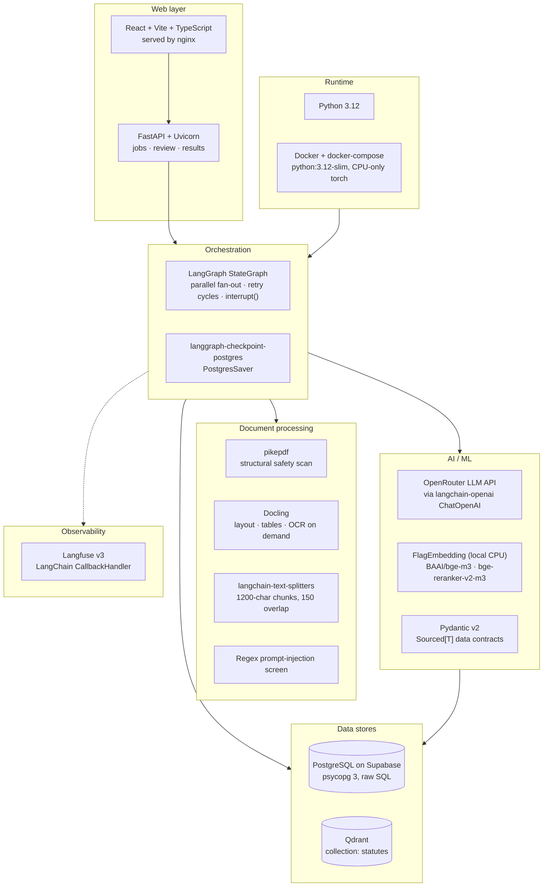

| Layer | Technology | What it does here | Where |
|---|---|---|---|
| Runtime | Python 3.12, Docker (`python:3.12-slim`, CPU-only torch), docker-compose | Two containers, `app` and `qdrant`. Postgres is hosted externally on Supabase | [Dockerfile](../../Dockerfile), [docker-compose.yml](../../docker-compose.yml) |
| Orchestration | **LangGraph** `StateGraph`, conditional edges, `interrupt()` / `Command(resume=)` | Main control graph: runs agents in parallel, loops retries, pauses for human review | [pipeline/graph.py](../../pipeline/graph.py) |
| Checkpointing | `langgraph-checkpoint-postgres` (`PostgresSaver`) | Saves graph state to Postgres after each step | [graph.py:409](../../pipeline/graph.py#L409) |
| LLM | **OpenRouter** (OpenAI-compatible API) via `langchain-openai` `ChatOpenAI` + `.with_structured_output(PydanticModel)` | 6 extraction agents and 1 validator. Default model `anthropic/claude-sonnet-5` | [pipeline/llm.py](../../pipeline/llm.py), [agents/base.py](../../pipeline/agents/base.py) |
| Data contracts | **Pydantic v2** (generic `Sourced[T]`, model validators) | Defines every agent output, the graph state and the final JSON | [schemas/](../../schemas/) |
| PDF safety | **pikepdf** | Checks structure: JavaScript, auto-actions, embedded files, size, page count | [pdf_safety.py](../../pipeline/pdf_safety.py) |
| Parsing / OCR | **Docling** (layout and table models; OCR only where the text layer is thin) | Turns the PDF into sections that follow its headings | [docling_parse.py](../../pipeline/docling_parse.py) |
| Chunking | `RecursiveCharacterTextSplitter` (1200 chars, 150 overlap) | Splits text into chunks that stay inside one section | [chunking.py](../../pipeline/chunking.py) |
| Embeddings / rerank | **FlagEmbedding**: `BAAI/bge-m3` (1024-d dense) + `bge-reranker-v2-m3` cross-encoder, local CPU, NumPy cosine | Routing fallback, statute ingestion, MISMATCH check | [embeddings.py](../../pipeline/embeddings.py) |
| Vector DB | **Qdrant** (collection `statutes`, cosine, 1024-d) | Similarity search over statutes, used **only** as a fallback | [statute_kb/](../../statute_kb/) |
| Relational DB | **PostgreSQL on Supabase** via **psycopg 3**, raw SQL | Statute data (source of truth), run results, validation logs, checkpoints | [db/schema.sql](../../db/schema.sql), [persistence.py](../../pipeline/persistence.py) |
| Observability | **Langfuse v3** `CallbackHandler` on the LangGraph run | One trace session per document | [observability/](../../observability/) |
| Config | `python-dotenv` + frozen `Settings` dataclass | Loads env vars; stops at startup if required ones are missing | [config.py](../../pipeline/config.py) |
| Guardrail | Regex prompt-injection screen | Flags suspicious chunks and blocks auto-save | [injection_screen.py](../../pipeline/injection_screen.py) |
| Docs tooling | LangGraph `draw_mermaid()` → mermaid.ink | Regenerates the graph diagram in `data_flow.md` | [architecture_doc.py](../../pipeline/architecture_doc.py) |
| HTTP API | **FastAPI** + **Uvicorn**, `python-multipart` | Upload, status/progress, human review, results, evaluation reports | [api/](../../api/) |
| Web UI | **React 18 + Vite + TypeScript** (no UI library) | Upload, live pipeline view, click-through to sources, review screen, evaluation dashboard | [ui/](../../ui/) |
| UI serving | **nginx** | Serves the built UI and proxies `/api` to the API container | [ui/nginx.conf](../../ui/nginx.conf) |
| Evaluation | Pure Python + Pydantic | Gold labels → accuracy, abstention, P/R/F1, calibration reports | [evaluation/](../../evaluation/) |
| Tests | **pytest** + FastAPI `TestClient` | API flows in demo mode and the scoring rules | [tests/](../../tests/) |

**Listed in [pyproject.toml](../../pyproject.toml) but never imported:** `supabase`, `sqlalchemy`,
`sentence-transformers` (FlagEmbedding may still pull it in) and `langchain` (core). Where the README
says "OpenAI", it means the OpenAI-compatible client pointed at OpenRouter.

---

## 3. Auth flow

There are **no user accounts**: no login, users table, JWT, OAuth or session. Two kinds of auth exist:

1. **Client → API (new):** an optional shared API key. When `API_KEY` is set, every `/api` route
   except `/api/health` requires a matching `X-API-Key` header (constant-time comparison). The UI
   stores the key in the browser and sends it on every request. Unset = open, for local demos.
2. **App → outside services:** the pipeline signs in to OpenRouter, Postgres, Qdrant and Langfuse
   with keys from `.env` (table below).

| Service | Credential | How it's sent | If missing or wrong |
|---|---|---|---|
| OpenRouter | `OPENROUTER_API_KEY` | `Authorization: Bearer` header via `ChatOpenAI(api_key, base_url)` ([llm.py:30](../../pipeline/llm.py#L30-L37)) | `RuntimeError` at startup |
| Supabase Postgres | `DATABASE_URL` (password inside the URI) | Postgres protocol via psycopg / PostgresSaver | `RuntimeError` at startup |
| Qdrant | `QDRANT_URL` + optional `QDRANT_API_KEY` | `api-key` header if set; local dev has none | URL required, key optional |
| Langfuse | `LANGFUSE_PUBLIC_KEY` / `LANGFUSE_SECRET_KEY` | The Langfuse SDK reads them from env itself | `auth_check()` logs a warning; the run continues without tracing ([langfuse_client.py:27](../../observability/langfuse_client.py#L27)) |
| HuggingFace Hub | none | Anonymous model download, cached in `.hf_cache` | — |

### 3.1 Credential flow for one run

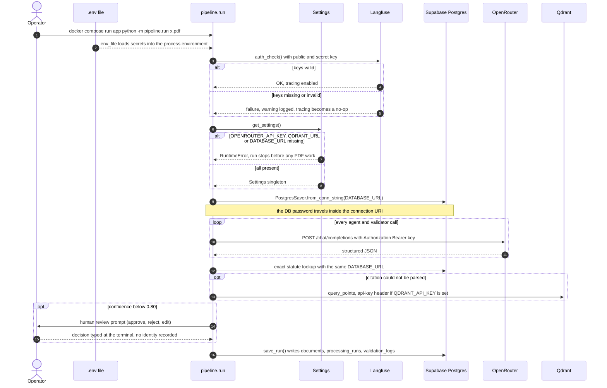

### 3.2 API key flow (web app → API)

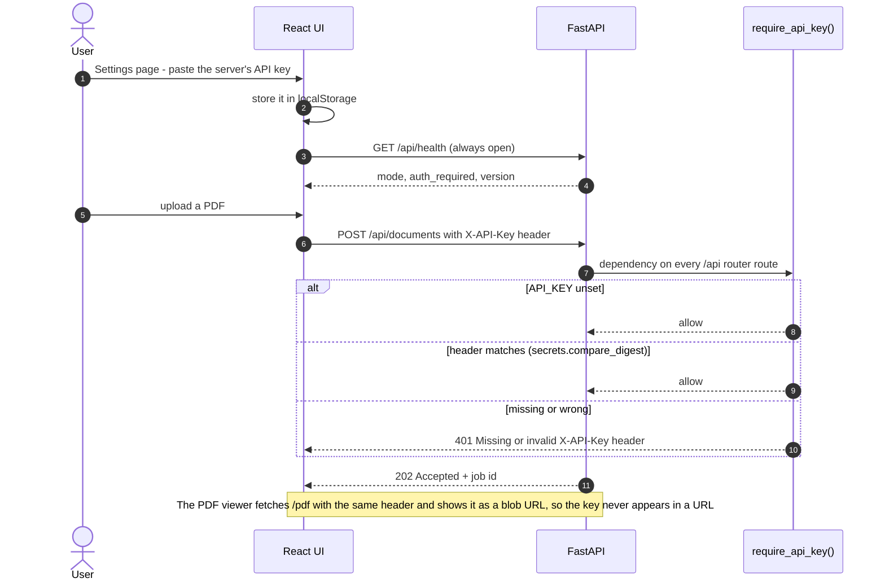

### 3.3 Things to know

- **`SUPABASE_URL`, `SUPABASE_PUBLISHABLE_KEY` and `SUPABASE_SECRET_KEY` are never read.** The app
  skips Supabase's API and Row-Level Security and connects straight to Postgres with the database
  password. That one login is used for everything: reading statutes, writing results and creating
  tables.
- **The Langfuse fields in `Settings` are unused** — the SDK reads the env vars directly.
- **Human review is the only approval step, and it doesn't record who approved.** Whoever is at the
  terminal types `a`, `r` or `e`. The decision is stored in `processing_runs.human_review_decision`.
  `traced_run_config` accepts a `user_id`, but the CLI never passes one.
- **A shared API key is not per-user auth.** Everyone with the key has the same access, and API
  reviews don't record who approved either. The next step is: Supabase Auth issues a JWT → FastAPI
  verifies it in the same dependency slot → a `user_id` column on `documents` / `processing_runs`,
  protected by RLS → the same `user_id` passed into `traced_run_config`.

---

## 4. High-level design (HLD)

### 4.1 System context

Blue = runs locally in Docker (`ui`, `api`, `app` and `qdrant` containers). Green = external hosted service.

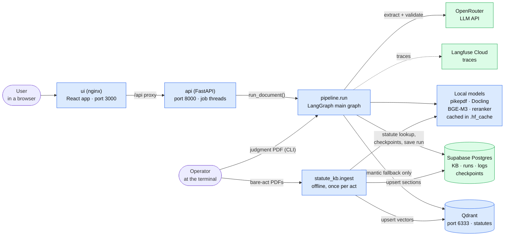

### 4.2 Offline flow — building the statute knowledge base

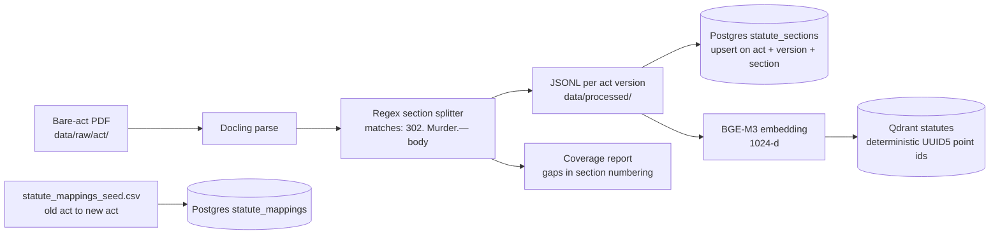

Code: [statute_kb/ingest.py](../../statute_kb/ingest.py), [parser.py](../../statute_kb/parser.py),
[mappings.py](../../statute_kb/mappings.py), [acts.py](../../statute_kb/acts.py). The `--embed-only`
flag runs the Qdrant step in a separate process because Docling's models and BGE-M3 together can
exceed container memory.

### 4.3 Online flow — processing one judgment

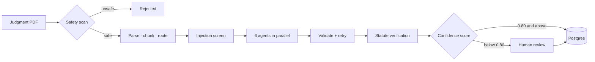

### 4.4 Design rules the code enforces

1. **Agents are isolated.** Each sees only its own routed chunks, never another agent's output.
2. **Every value carries a source** — page, chunk id and an exact quote (`SourceRef`).
3. **The statute KB only checks citations.** It never feeds extraction.
4. **Confidence is calculated in code**, never self-reported by the LLM.
5. **None over guessing.** A field that fails validation is set to `None` or dropped, never shipped.

---

## 5. Low-level design (LLD)

### 5.1 The compiled LangGraph

Amber nodes call the LLM. Diamond nodes make a routing decision.

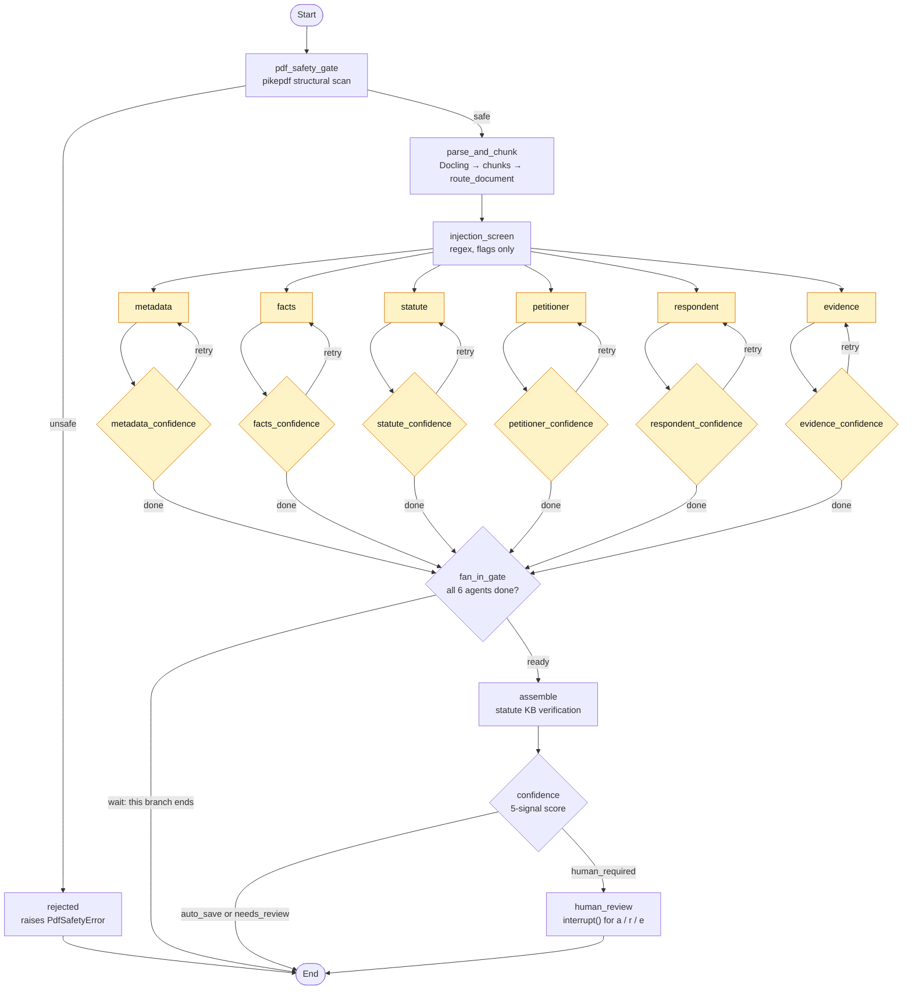

**Why `fan_in_gate` exists:** LangGraph runs a node every time *any* incoming branch finishes, not
once all of them have. Without the gate, `assemble` fired early on an agent's mid-retry output. Each
`<agent>_confidence` node sets `agents_done[agent] = True` only when that agent is truly finished, and
the gate proceeds only once all six are in.

| Node | Calls LLM? | Reads | Writes |
|---|---|---|---|
| `pdf_safety_gate` | no | `source_path` | `pdf_safety_reasons` |
| `parse_and_chunk` | no | `source_path` | `chunk_count`, `ocr_used`, `agent_inputs` (+ chunks in `RunContext`) |
| `injection_screen` | no | chunks | `injection_matches` |
| `<agent>` ×6 | **yes** — 1 extraction call | `agent_inputs[agent]`, `retry_counts[agent]` | its own output slot (`metadata`, `facts`, `statutes`, …) |
| `<agent>_confidence` ×6 | **yes** — 1 batched validator call | that agent's output | `validations`, `retry_counts`, `retry_decision`, `agents_done`; pruned output when retries run out |
| `fan_in_gate` | no | `agents_done` | — |
| `assemble` | no (local reranker) | `statutes`, `metadata.decision_date` | `statutes` with verification results |
| `confidence` | no | all outputs, `validations`, `injection_matches` | `confidence`, `result` |
| `human_review` | no | `validations`, `confidence`, `result` | `result` (if edited or rejected) |

**State merging:** the six branches write to the same dict fields (`validations`, `retry_counts`,
`retry_decision`, `agents_done`). Those are declared `Annotated[dict, operator.or_]` so parallel
writes merge instead of overwriting each other. Chunks and the embedding index live in `RunContext`,
outside the checkpointed state, because they aren't serializable.

### 5.2 Sequence for one document

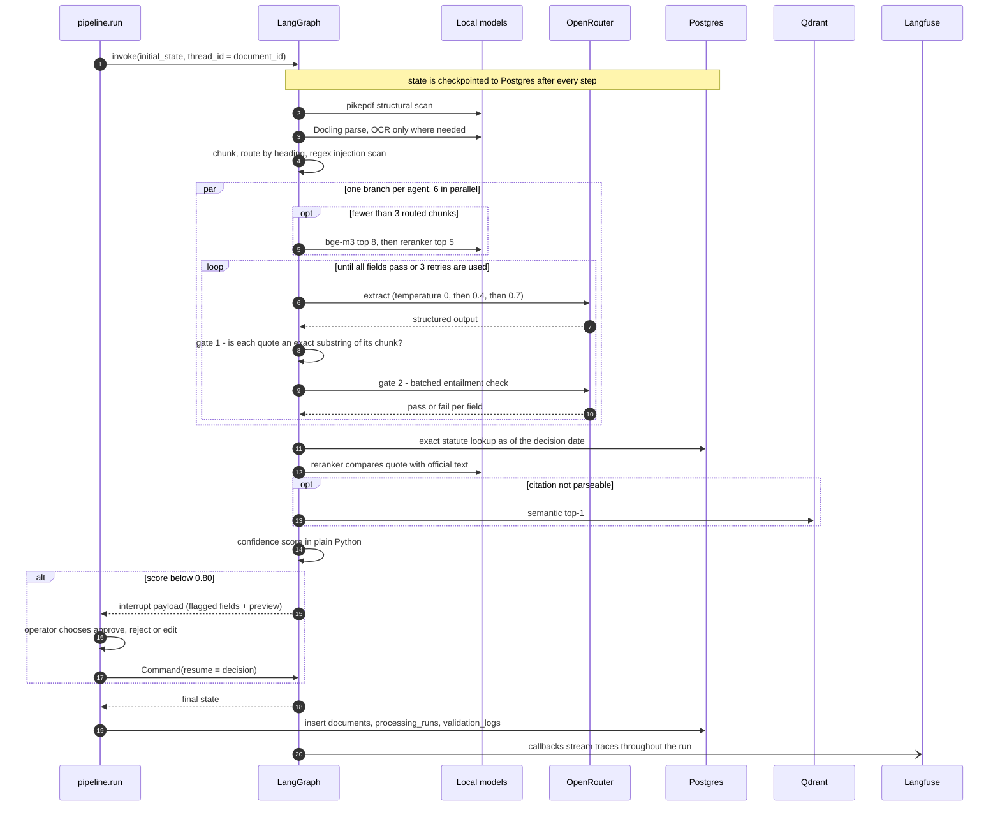

**LLM calls per document:** about 12 at best (6 extractions + up to 6 validator calls), up to 48 at
worst (4 attempts × 12).

### 5.3 Routing — which chunks each agent sees

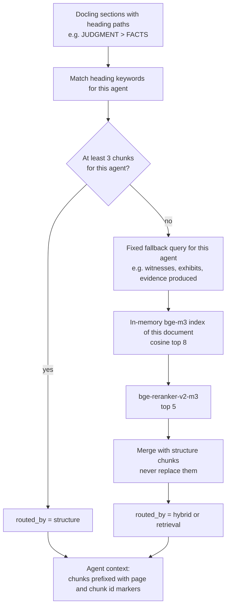

| Agent | Heading keywords ([router.py](../../pipeline/router.py)) |
|---|---|
| metadata | IN THE, CORAM, BENCH, JUDGMENT, ORDER, CASE NO |
| facts | FACTS, BACKGROUND, BRIEF FACTS, CASE OF THE PROSECUTION |
| statute | STATUTE, PROVISION, SECTION, CHARGE |
| petitioner | PETITIONER, APPELLANT, PLAINTIFF, SUBMISSION OF THE APPELLANT |
| respondent | RESPONDENT, STATE, DEFENDANT, SUBMISSION OF THE RESPONDENT |
| evidence | EVIDENCE, WITNESS, EXHIBIT, TESTIMONY |

### 5.4 Agent → validate → retry cycle

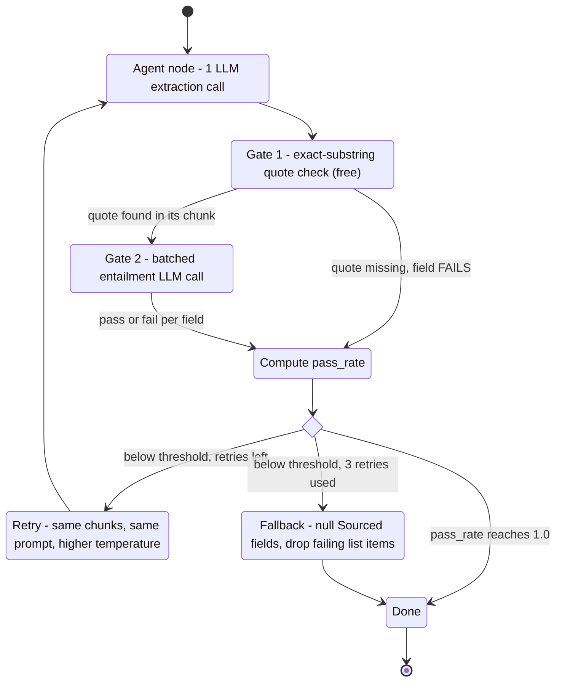

| Attempt | Temperature | Notes |
|---|---|---|
| 0 | 0.0 | first run |
| 1 | 0.4 | retry 1 |
| 2 | 0.7 | retry 2 |
| 3 | 0.7 | retry 3 (ladder index is capped at 2) |

Retries are **blind**: no validator feedback reaches the agent; only the temperature changes. The
threshold is per agent (`NodeLLMConfig.confidence_threshold`, default 1.0 = every field must pass) in
[llm_config.py](../../pipeline/llm_config.py). Code: [validation.py](../../pipeline/validation.py),
[fallback.py](../../pipeline/fallback.py), [graph.py:214-244](../../pipeline/graph.py#L214-L244).

### 5.5 Statute verification

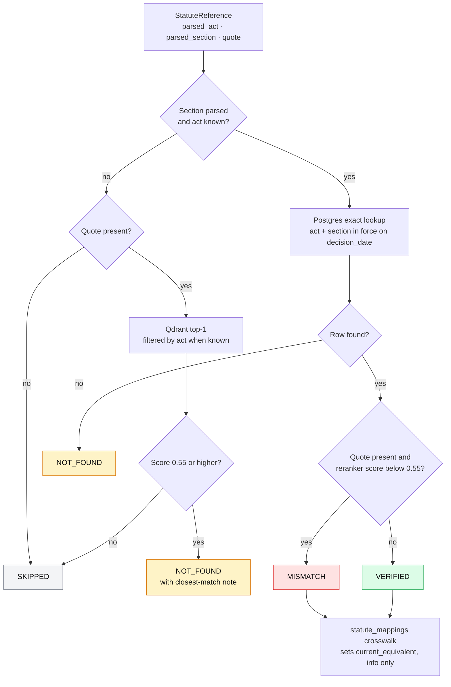

Postgres is the source of truth. Vector similarity from Qdrant **never** produces `VERIFIED` — at
most a `NOT_FOUND` with a hint. Code: [statute_kb/lookup.py](../../statute_kb/lookup.py),
[pipeline/statute_verification.py](../../pipeline/statute_verification.py).

### 5.6 Confidence scoring and routing

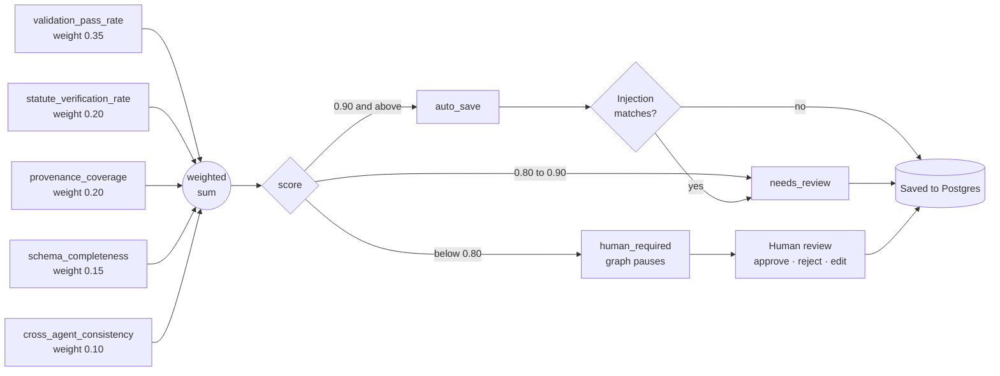

| Signal | Weight | How it's computed |
|---|---|---|
| `validation_pass_rate` | 0.35 | Mean of each agent's field pass rate |
| `statute_verification_rate` | 0.20 | VERIFIED citations ÷ all citations (1.0 if none) |
| `provenance_coverage` | 0.20 | Share of present fields whose source has a chunk id and page |
| `schema_completeness` | 0.15 | Share of `court`, `decision_date`, `case_number` that are present |
| `cross_agent_consistency` | 0.10 | Penalises timeline events dated after the decision date |

Code: [pipeline/confidence.py](../../pipeline/confidence.py),
[schemas/confidence.py](../../schemas/confidence.py).

### 5.7 Data model — Pydantic contracts

**Provenance building blocks** ([schemas/base.py](../../schemas/base.py)). Every extracted value in
the system is wrapped in one of these:

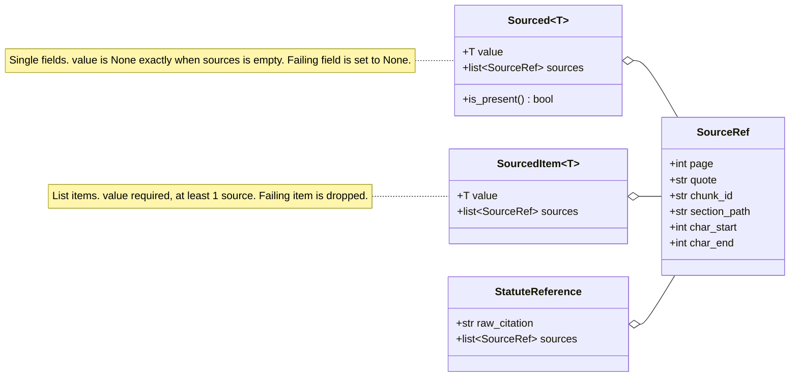

**The final record** ([schemas/final.py](../../schemas/final.py)) — what gets stored in
`processing_runs.structured_json`:

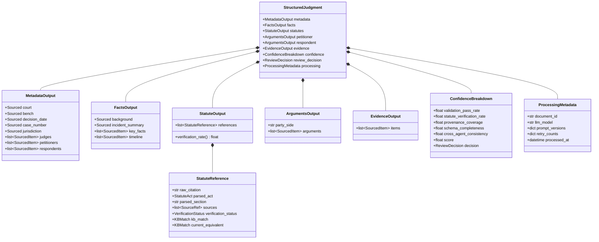

### 5.8 Data model — Postgres tables

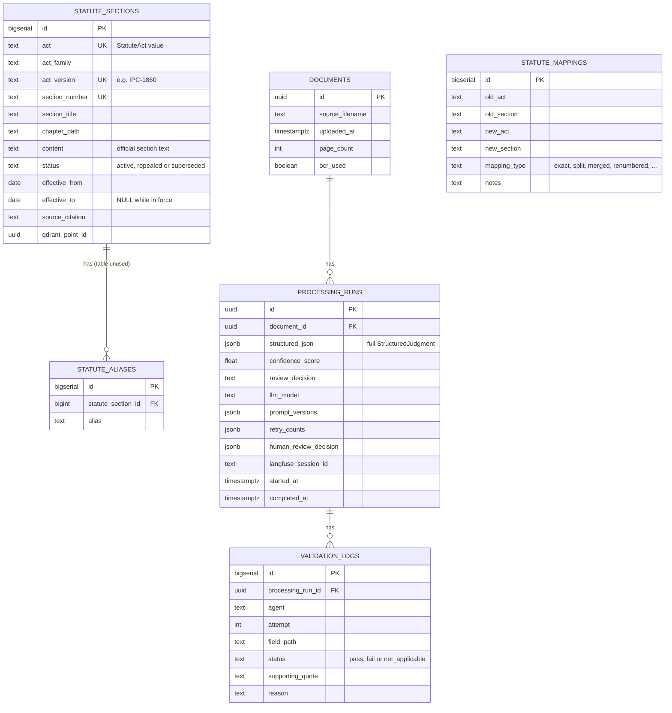

`statute_mappings` has no foreign key; it is joined on act and section values. LangGraph's own
checkpoint tables (created by [scripts/setup_checkpointer.py](../../scripts/setup_checkpointer.py))
live in the same database.

### 5.9 API layer ([api/](../../api/))

The API never re-implements the pipeline. Each upload becomes a **job**; a background thread calls the
same `run_document()` the CLI uses, with two callbacks: `on_progress` (fed by streaming the graph
node by node) and `on_human_review` (blocks the thread until a reviewer answers over HTTP).

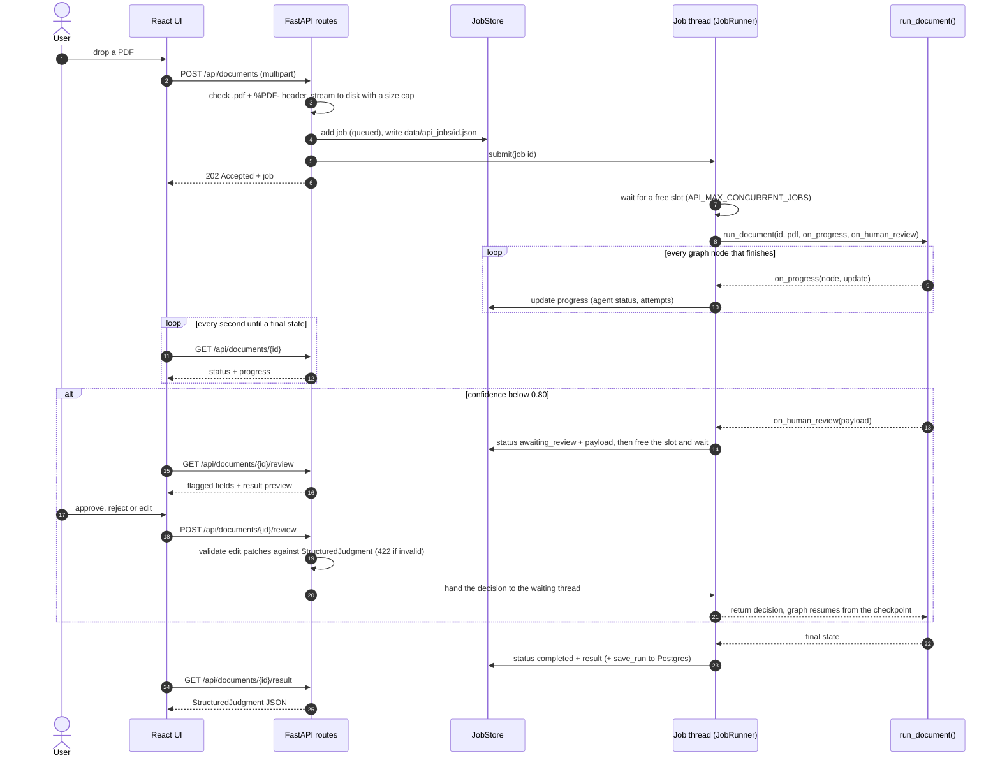

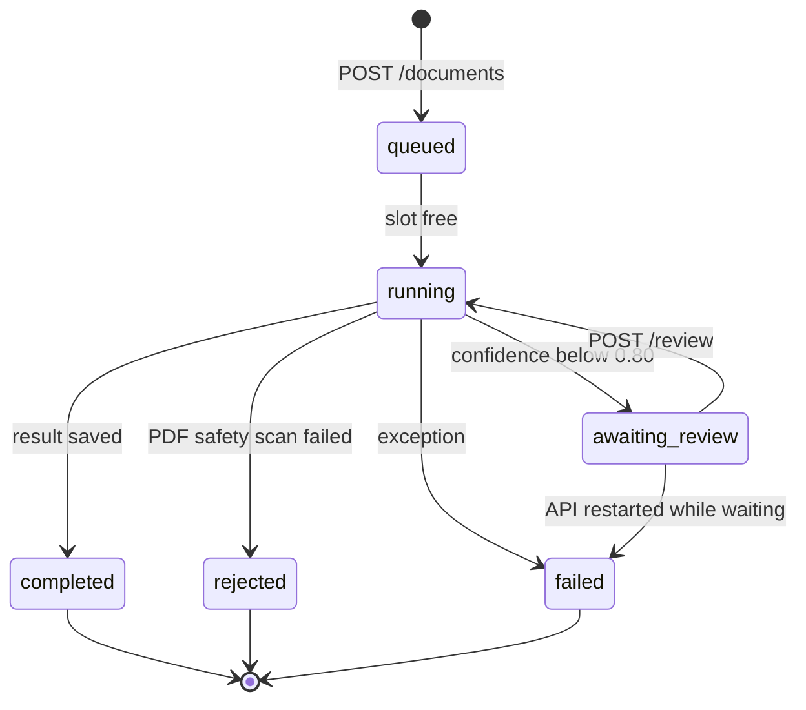

**Why a thread waits for the reviewer instead of resuming from the checkpoint later:** the run's
chunks and embedding index live only in that call's memory (`RunContext`, not checkpointed), so a
different process could not resume it. Keeping the run alive avoids changing the pipeline; the
documented trade-off is that a paused run does not survive an API restart (it is marked `failed`).
The waiting thread releases its concurrency slot, so a pending review never blocks new uploads.

| Piece | File | Responsibility |
|---|---|---|
| Routes, upload checks, auth | [main.py](../../api/main.py) | `create_app(settings, pipeline)` factory, so tests inject temp dirs and demo mode |
| Settings | [config.py](../../api/config.py) | Env vars; starts without pipeline credentials in demo mode |
| Jobs | [jobs.py](../../api/jobs.py) | `Job` model + thread-safe store, mirrored to JSON on disk (atomic rename) |
| Worker | [worker.py](../../api/worker.py) | Threads, concurrency slots, review hand-off, progress folding |
| Pipeline adapters | [pipelines.py](../../api/pipelines.py), [demo.py](../../api/demo.py) | `RealPipeline` (LangGraph, imported lazily) and `DemoPipeline` (synthetic) |

### 5.10 Evaluation ([evaluation/](../../evaluation/))

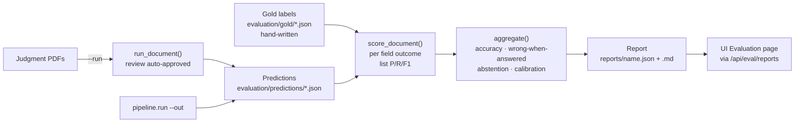

Each labelled single-value field gets one of five outcomes — `correct`, `correct_absent`, `missed`,
`wrong`, `spurious` — so the report can separate "wrong when it answered" from "declined to answer".
Calibration compares the confidence score with per-document accuracy: if the score is meaningful,
auto-saved documents should be more accurate than ones sent for review.

---

## 6. Where the docs and the code disagree

1. **The validator uses the same model as the extractors.** `VALIDATOR_LLM_MODEL` is read but never
   used ([validation.py:112](../../pipeline/validation.py#L112)).
2. **The `<agent>_confidence` nodes do call the LLM.** The generated node table in
   [data_flow.md](data_flow.md) says "no LLM call", but these nodes run the validator. The text is
   hardcoded in [architecture_doc.py:64](../../pipeline/architecture_doc.py#L64).
3. **Some env vars do nothing.** `CONFIDENCE_AUTOSAVE_THRESHOLD`, `CONFIDENCE_REVIEW_THRESHOLD` and
   `DOCLING_OCR_DENSITY_THRESHOLD` have no effect; the thresholds are hardcoded in
   [schemas/confidence.py:60-65](../../schemas/confidence.py#L60-L65).
4. **`prompt_versions` is never filled in**, so it's always saved as `{}`, even though the docs say a
   prompt hash is stored with every result.
5. **A crashed run can't actually resume.** Every CLI run gets a new `uuid4` thread id
   ([run.py:66](../../pipeline/run.py#L66)), and chunks aren't saved in checkpoints
   ([graph.py:123](../../pipeline/graph.py#L123)). In practice, checkpointing only supports the
   human-review pause. The API works around this by keeping a paused run alive in its thread (§5.9).
6. **The statute data in the repo is much smaller than the docs say.** IPC has 201 sections, numbered
   76–502, with 245 numbers missing in that range. CrPC has 458 sections. There is no Constitution,
   BNS, BNSS or BSA data, and the old-to-new mapping CSV has only a header row, so
   `current_equivalent` is always `None`. (What's loaded in the live databases may differ.)
7. **The MISMATCH check may wrongly flag correct citations — worth testing.** It compares the
   judgment's quoted sentence (e.g. "convicted under Section 302 IPC") with the full official section
   text and flags anything scoring below 0.55 ([lookup.py:157](../../statute_kb/lookup.py#L157)).
8. **`validation_logs` keeps only each agent's last attempt**, not the full retry history.
   `documents.page_count` is always NULL.
9. **Human review edits skip quote validation.** An edit replaces top-level fields without
   re-checking the quotes, and a reject still saves the run. (The API at least validates an edit
   against the schema before resuming, so a malformed edit is a 422 instead of a crashed run.)
10. **The embedding index is built for every agent call, even when unused.** `ctx.index` is passed as
    an argument to `apply_retrieval_fallback()`, so it is evaluated before the function decides
    whether it needs it — and six parallel agents can each trigger the first, expensive build.

### Fixed while adding the API

- **Human review crashed on resume.** After an interrupt, LangGraph reloads state from the
  checkpoint with plain-string dict keys, and `human_review_node` / `save_run()` call `agent.value`
  on them → `AttributeError`. Any run scoring below 0.80 could not finish, from the CLI or anywhere
  else. Fixed by typing `GraphState`'s dicts as `dict[AgentName, ...]` so Pydantic restores the enum
  keys ([graph.py:89-120](../../pipeline/graph.py#L89-L120)); verified by running the real graph with
  stubbed models through interrupt, resume and `save_run`'s key handling.
- **Docling reloaded its models for every document.** `_build_converter()` is now cached, which
  matters for a long-running API process.

### Heads-up

- LangGraph logs *"Deserializing unregistered type … will be blocked in a future version"* for the
  Pydantic models in checkpoints. A future LangGraph upgrade will need those modules allow-listed
  in the checkpointer's serializer, or human-review resume will break again.
